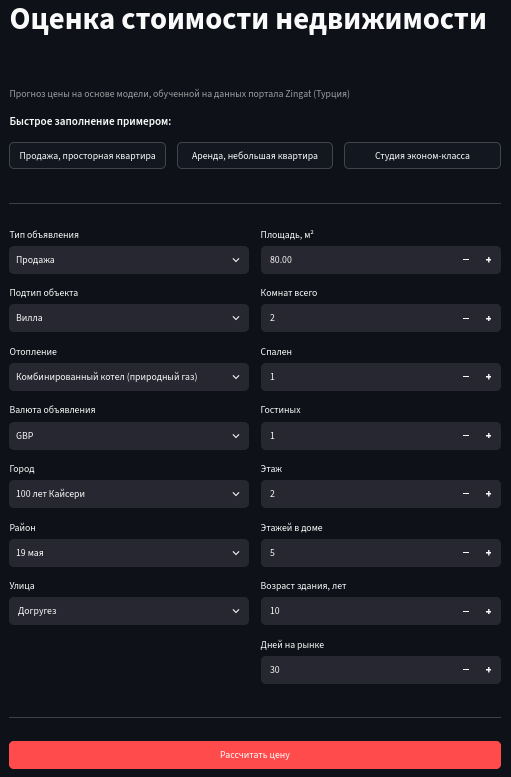
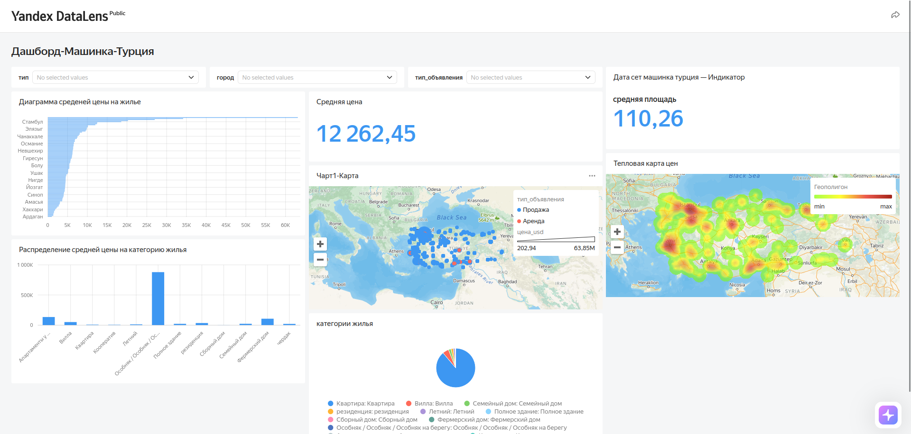

# Прогнозирование цен на жилье в Турции

Учебный проект по анализу рынка недвижимости Турции и прогнозированию цен на основе датасета платформы **Zingat**. Включает очистку данных, разведочный анализ, обучение моделей машинного обучения, дашборд в DataLens и приложение для оценки стоимости объекта.

## О проекте

Цель: проанализировать рынок недвижимости Турции и построить модель, которая по характеристикам объекта (тип, площадь, комнаты, этаж, возраст здания, местоположение, отопление) оценивает цену в USD для объявлений о продаже и аренде.

## Данные

- Источник: датасет Zingat, 403 487 объявлений, 17 столбцов (2018–2019 годы).
- Содержит тип и подтип недвижимости, адрес (город/район/улица), площадь, комнаты, этаж, возраст здания, отопление, цену и валюту, время на рынке.
- После очистки в работе осталось 369 746 объектов.

## Что было сделано

1. **Перевод данных** с турецкого на русский (googletrans и ручная доработка).
2. **Очистка и преобразование:**
   - адрес разделён на город, район и улицу;
   - возраст здания, этаж и этажность приведены к числам;
   - комнаты «3+1» разложены на спальни, гостиные и общее число комнат;
   - пропуски заполнены медианой или самым частым значением по группе;
   - цены приведены к USD;
   - выбросы обрезаны по 1–99 перцентилям отдельно для продажи и аренды.
3. **Разведочный анализ (EDA):** распределения, корреляции, цены по типам объектов, городам, районам и отоплению.
4. **Подготовка к обучению:** логарифмирование цены, One-Hot кодирование, сглаженное target-кодирование города, района и улицы (обучено только на train, без утечки данных), разбиение 80/20.
5. **Моделирование:** Decision Tree, Random Forest, Gradient Boosting (HistGradientBoosting), подбор гиперпараметров через GridSearchCV, проверка на переобучение.
6. **Проверка на новых данных:** прогноз на 20 отдельных объектах, метрики MAE, RMSE, R² посчитаны вручную и через sklearn.
7. **Приложение** для оценки цены и **дашборд DataLens**.

## Результаты

| Модель | MAE, $ | RMSE, $ | MAPE, % | R² |
|---|---|---|---|---|
| Decision Tree | 2 420 | 7 439 | 26.4 | 0.772 |
| **Random Forest** | **2 004** | **6 539** | **21.1** | **0.824** |
| Gradient Boosting | 2 339 | 7 225 | 24.5 | 0.785 |

Лучшая модель: **Random Forest**.

На отдельной тестовой выборке из 20 объектов: MAE = 2 525 $, RMSE = 6 825 $, MAPE = 32%, R² = 0.86.

**Ключевые выводы:**
- Продажа и аренда различаются по цене на два порядка, поэтому тип объявления самый важный признак.
- Для продажи цена сильнее всего зависит от площади, числа комнат и местоположения.
- Модель хорошо оценивает типичные объекты. Редкие дорогие курортные объекты она занижает, а в аренде относительная ошибка выше.

## Приложение
В проект входит приложение для оценки стоимости недвижимости: пользователь вводит характеристики объекта и получает прогноз цены. Приложение показывает также диапазон цен с учётом MAE модели. Приложение сделано на Streamlit.

### Общий вид приложения

### Расчёт цены

### Справка

## Дашборд
Интерактивный дашборд в Yandex DataLens: [открыть дашборд](https://datalens.yandex/noq9ntx9b1lo6?_share_link=public)

## Ограничения

- Цены пересчитаны по единому курсу 1 TRY = 1/34 USD, хотя объявления относятся к 2018–2019 годам. Значения условны и подходят для сравнения объектов между собой.
- Автоматический перевод названий местами неточен.
- Редкие дорогие объекты модель недооценивает, а прогноз аренды менее точен, чем продажи.

## Возможные улучшения

- Отдельные модели для продажи и аренды.
- Курс валюты на дату объявления.
- Дополнительные признаки (состояние объекта, координаты).

## Стек

Python, pandas, NumPy, SciPy, scikit-learn, matplotlib, seaborn, joblib, googletrans, Yandex DataLens.

## Авторы

Галиаскарова Гульшат Фанзилевна, Служителев Артём Игоревич, группа 23П-2
